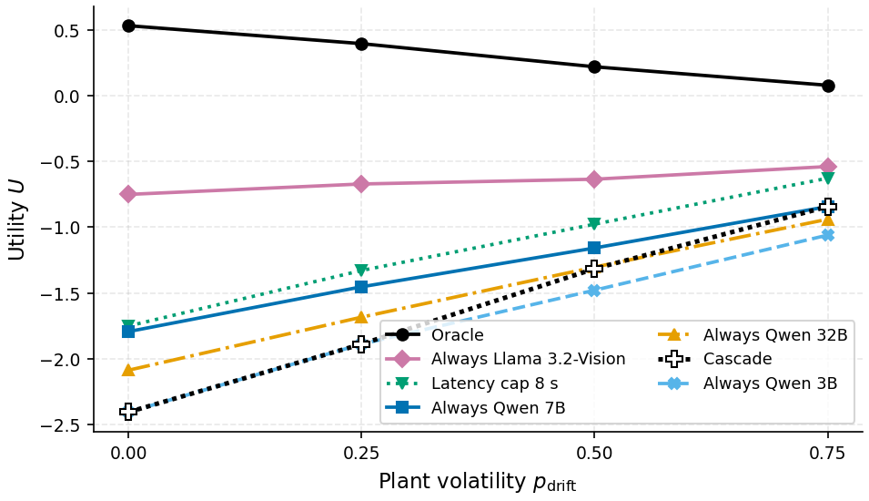

# Secondary suites (B3–B5) and additional results

This document holds the protocols and full results that the paper summarizes in its last results
subsection (secondary suites B3–B5), plus details that the paper reports only in one sentence
(live consistency per model, detector fitting, corrected prompts and repeatability, platform).
Every number is produced by the scripts in `XAIR_Runtime/experiments/` and stored in
`XAIR_Runtime/experiments/results/`; the source file is given under each table.

Notation follows the paper: `U` is the mean per-trial reward (+1 per successful release,
−λ per adverse publication, −μ per wrongful revocation; λ = 5, μ = 1), SAR the
successful-actuation rate, Adverse the share of stale or misgrounded publications (a proxy for harm), WRR the
wrongful-revocation rate among context-valid intents. Unless stated otherwise, results are on the
612 held-out test frames over five seeds, with `p_drift = 0.5`, drift offset τ = 250 ms, and capture
anchoring; intervals are frame-cluster bootstrap 95% intervals.

## 1. Protocols

Frames are split 70/30 by frame identity, stratified on category and use case; all decisions for a
frame stay in the same partition and learners see only training frames. The seeds vary drift,
training order, and exploration; each perception output and its latency is a single draw.

**B3, learned validity budgets.** A budget chooses one of ten actions `(w, strictness)`, with
`w ∈ {500, 1000, 2000, 4000, 8000}` ms and strictness either *lenient* (freshness-only) or *strict*
(full XAIR), for the decisions of all five models. LinUCB (exploration coefficient 1.0) uses latency,
confidence, precondition count, schema validity, the model's own defect judgment, the use case, and
the model; tabular ε-greedy Q-learning (ε = 0.15, learning rate 0.25, no discounting, hence a
contextual bandit) uses a discretized latency, the model, and the defect judgment. Both learn online
over two passes of the training frames under mixed drift. Mask-derived severity is withheld; a
privileged ablation re-adds it. The best fixed budget maximizes mean training reward under the
evaluation setting, and the oracle, which knows drift and correctness, picks the best action per
decision.

**B4, post-hoc selection among preserved outputs.** A selector decides which preserved decision to
submit for frames with at least four model outputs including the primary model (all 2,000 frames;
all five models for 1,993). Selectors observe latency, schema validity, and precondition count (the
cascade additionally uses the drift probability); the reported latency is that of the chosen
decision. The default window `w = max(2000, ⌈Δ_inf⌉ + 250)` ms always exceeds the chosen decision's
latency, so the freshness check never binds; a variant with a fixed 4 s window restores it.

**B5, post-revocation policies.** The 7B decision is submitted first; after a revocation, a policy
may abstain, retry the same observation, re-observe, or escalate to another model (32B, Gemma 3,
Llama, 3B, with at most two extra steps). Re-observation does not re-query the model: it advances
the capture clock and restores nominal context with probability `p_recover` (default 0.35) while
reusing the same decision. Drift and recovery depend only on the seed and the frame, so every policy
faces the same plant realization. Every attempt is validated by full XAIR with the adaptive window of
B4, and episode utility sums per-attempt rewards and a cost of 0.05 per extra step. LinUCB
(exploration 0.75) and Q-learning (ε = 0.1, learning rate 0.25) observe latency, schema validity,
precondition count, gate reason, step count, and whether escalation is possible, and credit every
decision of an episode with its return. The oracle is a hindsight one-step lookahead.

## 2. Summary

| Suite | Baseline (U) | Best policy | ΔU [95% CI] | Oracle U |
|---|---|---|---|---|
| B3 | fixed budget, revokes every intent (−0.210) | LinUCB | −0.0003 [−0.004, +0.003] | +0.196 |
| B4 | always 7B (−1.158) | always Llama 3.2-Vision | +0.52 [+0.37, +0.68] | +0.222 |
| B5 | single-shot abstention (−1.201) | LinUCB | −0.0001 [−0.001, +0.001] | −1.072 |

ΔU is the paired frame-cluster difference of the best learned policy (B3, B5) or best non-oracle
selector (B4) with respect to the baseline. Sources: `b3_validity_budget.json`,
`b4_routing_table.csv`, `b5_headline_table.csv`, `paper2_stats.json`.

## 3. Learned validity budgets (B3)

Every seed selects a revoke-all budget as the best fixed one (the four budgets with `w ≤ 1000` ms
tie; reported as `w = 500` ms lenient), and both learners converge to the same operating point:
LinUCB minus best fixed ΔU = −0.0003 [−0.0037, +0.0027], Q-learning ΔU = −0.0026 [−0.0050, −0.0005],
with WRR of at least 0.99 for all three. The null result is largely analytic: with τ below every
latency, a scheduled drift always precedes submission, so a lenient publication has expected reward
at most `(1 − p_drift) − λ p_drift` and a revocation at least `−(1 − p_drift) μ`. At λ = 5 and
`p_drift = 0.5` revoking dominates for any grounding accuracy, and strict publication would pay off
only at accuracies far above the 42.5% of the five-model test pool.

| Policy | U [95% CI] | SAR | Adverse | WRR |
|---|---|---|---|---|
| Oracle | +0.196 [0.182, 0.210] | 0.203 | 0.000 | 0.033 |
| Best fixed (train) | −0.210 [−0.224, −0.197] | 0.000 | 0.000 | 1.000 |
| LinUCB | −0.210 [−0.224, −0.198] | 0.002 | 0.001 | 0.991 |
| Q-learning | −0.212 [−0.227, −0.199] | 0.000 | 0.001 | 0.998 |
| Fixed `w = 4000` strict | −0.871 [−0.933, −0.808] | 0.106 | 0.175 | 0.495 |

Decisions of all five models; lenient = freshness-only, strict = full XAIR. Source:
`b3_validity_budget.json`.

Re-selecting and re-training under other weights shows where learning can matter. At λ = 1 the best
fixed budget becomes `w = 8000` ms strict (U = −0.119, WRR 0.14) and LinUCB improves on it by 0.026
(U = −0.093, a point estimate over five seeds) by publishing more (WRR 0.38), whereas Q-learning, with
its coarser state, does not (−0.180). At λ = 2 the best fixed budget again revokes everything and
LinUCB is 0.011 better; at λ = 5 revoke-all is selected for every `p_drift ∈ {0.1, 0.25, 0.5}`.
Re-adding ground-truth severity as a privileged feature raises LinUCB to U = −0.085, recovering 0.125
of the 0.406 gap to the oracle (U = +0.196, WRR 0.033); closing the rest requires knowledge of drift
and correctness that no emission-time policy has (`paper2_revision_analyses.json`, `b3_reselection`).

A category hold-out, with nine of the 27 categories assigned entirely to test, gives the same picture
(oracle +0.197, best fixed −0.210, LinUCB −0.213, Q-learning −0.250). Blind 7B grounding on the
held-out categories (50.4%) differs from that on the training categories (52.4%) by −2.0 points
(95% CI [−6.6, +2.6]), which for a zero-shot model reflects category difficulty rather than
generalization (`paper2_revision_analyses.json`, `category_holdout`).

## 4. Post-hoc selection among preserved outputs (B4)

Under the adaptive window the freshness check never binds, and selectors differ only through
grounding, schema validity, and precondition content. Always submitting Llama 3.2-Vision gives the
best non-oracle utility despite near-weakest grounding (0.364): its frequent schema failures are
revoked, and with them six in ten of its context-valid intents (WRR 0.600). Latency caps prefer
outputs with more preconditions, and the 8 s cap selects Llama on 254 of 612 test frames, so its
advantage over always-7B is again a revocation effect rather than a latency effect.

| Selector | U [95% CI] | Grounding | p50 latency (s) | Adverse | WRR |
|---|---|---|---|---|---|
| Oracle | +0.222 [0.154, 0.284] | 0.578 | 3.16 | 0.031 | 0.009 |
| Always Llama | −0.634 [−0.743, −0.532] | 0.364 | 3.37 | 0.120 | 0.600 |
| Latency cap 8 s | −0.976 [−1.106, −0.847] | 0.433 | 3.28 | 0.216 | 0.266 |
| Always Qwen 7B | −1.158 [−1.332, −1.000] | 0.511 | 3.29 | 0.274 | 0.081 |
| Always Qwen 32B | −1.303 [−1.457, −1.142] | 0.480 | 6.80 | 0.307 | 0.020 |
| Cascade | −1.316 [−1.481, −1.150] | 0.507 | 3.23 | 0.313 | 0.000 |
| Always Qwen 3B | −1.479 [−1.617, −1.343] | 0.408 | 2.66 | 0.336 | 0.014 |
| Always Gemma 3 | −1.652 [−1.788, −1.511] | 0.359 | 3.28 | 0.365 | 0.018 |

Adaptive window. Source: `b4_routing_table.csv`.

*B4 utility of representative selectors as `p_drift` increases (capture anchoring, adaptive window).*
The ordering of the oracle, Llama, the latency cap, and always-7B is stable across volatility levels,
while the cascade moves between the 3B and 7B levels. Utility rises with volatility because, with τ
below every latency, drift turns would-be adverse publications of misgrounded actions into correct
revocations. Fixing the window at 4 s lets latency bind and changes the ordering: always-32B, whose
decisions all exceed the window, becomes the best non-oracle selector (U = −0.24) by revoking every
intent (WRR 1.0), ahead of Llama (−0.52) and always-7B (−0.75) (`b4_routing_table_fixedw.csv`). In
both variants, selection improves utility by choosing outputs that the gate is more likely to revoke,
not through a better grounding–latency trade-off.

## 5. Post-revocation policies (B5)

With common random numbers every B5 policy shares the first attempt, and single-shot abstention
publishes nothing afterwards, so no policy can have lower adverse rate than single-shot. Always
re-observing raises successful release by 0.132 [0.117, 0.147] but adverse publication by 0.101 [0.087, 0.116],
for ΔU = −0.469 [−0.550, −0.388]. Because offline re-observation reuses the same decision, plant
recovery turns correct revocations of misgrounded actions into adverse publications; the adverse-rate
increase and its growth with `p_recover` (from 0.283 at 0 to 0.440 at 0.7, `b5_precover_sweep.csv`)
follow from this modeling choice. Retry-stale reproduces the single-shot outcome in every episode and
only adds the step costs and repeated revocation penalties of its extra attempts (ΔU = −0.083).
Escalation reaches a WRR of zero by moving to another model instead of revoking, at an adverse-publication cost of
0.037. LinUCB learns to abstain (1.02 steps on average; ΔU = −0.0001 [−0.0009, +0.0011]), and
Q-learning is slightly worse than single-shot (−0.015 [−0.024, −0.008]). The hindsight oracle, which
recovers 0.15 additional successful release without extra adverse publication, marks what selective recovery
could reach with hindsight.

| Policy | U [95% CI] | ΔU vs single-shot | SAR | Adverse | Steps | WRR |
|---|---|---|---|---|---|---|
| Oracle | −1.072 [−1.247, −0.901] | +0.129 | 0.380 | 0.283 | 1.42 | 0.008 |
| Single-shot | −1.201 [−1.368, −1.036] | ref. | 0.230 | 0.283 | 1.00 | 0.070 |
| LinUCB | −1.201 [−1.367, −1.036] | −0.0001 | 0.231 | 0.283 | 1.02 | 0.070 |
| Q-learning | −1.216 [−1.382, −1.053] | −0.015 | 0.231 | 0.285 | 1.09 | 0.070 |
| Retry-stale | −1.284 [−1.445, −1.121] | −0.083 | 0.230 | 0.283 | 1.97 | 0.070 |
| Always escalate | −1.413 [−1.586, −1.250] | −0.213 | 0.248 | 0.320 | 1.92 | 0.000 |
| Always re-observe | −1.669 [−1.871, −1.463] | −0.469 | 0.362 | 0.384 | 1.83 | 0.070 |

WRR over episodes whose first decision was context-valid. Source: `b5_headline_table.csv`.

## 6. Details reported in one sentence in the paper

**Platform.** Phase P used Ollama 0.17.7 on one NVIDIA L40 (46 GB), temperature 0, an 8,192-token
context, and bounded timeouts and retries; images were converted to RGB, JPEG-encoded, and downscaled
to a maximum side of 1024 px. The default tags of the five models resolve to Q4_K_M quantizations in
the installations used for the corrected-prompt rerun (identifiers in `XAIR_Runtime/PAPER2_ARTIFACT.md`);
the digests of the original campaign were not recorded. Thirty-one calls of the 7B no-context variant
were re-issued at 768 or 512 px after repeated timeouts, and 8 of 18,000 calls (0.04%; five of the
3B, two of Gemma 3, one of the 7B no-context variant) never completed and are excluded. The
constrained arm used Ollama structured outputs; Qwen3-VL 8B Instruct is also Q4_K_M.

**Offline–live consistency.** The live check submits 500 primary-model frames at `w = 4000` ms
through the adapter and XAIR (3,000 path and anchor comparisons per run); over five runs online and
offline decisions disagreed on 0, 1, 2, 0, and 0 comparisons, each a decision less than 12 ms inside
the window. Two divergences found by this check were removed first: the live schema now restricts
actions to the cell's vocabulary, as the replay does (98 Llama decisions name a non-existent action),
and live submissions carry the evidence age of retried calls. One further run per model uses a random
sample of 1,990 decisions (each model completed at least 1,995; six path and anchor comparisons per
decision):

| Model | Comparisons | Disagreements | Largest distance to `w` |
|---|---|---|---|
| Qwen2.5-VL 7B | 11,940 | 3 | 5.0 ms |
| Qwen2.5-VL 3B | 11,940 | 5 | 4.9 ms |
| Qwen2.5-VL 32B | 11,940 | 0 | – |
| Gemma 3 12B | 11,940 | 0 | – |
| Llama 3.2-Vision 11B | 11,940 | 0 | – |

Every disagreement is a capture-anchored decision within a few milliseconds of the window whose live
elapsed time crossed it (`b2_fidelity_runs.json`). The schema+freshness path, the constrained and
Qwen3-VL arms, and the queueing-delay replay use the same evaluator but were not separately checked
live.

**Controlled detector producer.** The detector follows PatchCore: layer-2 and layer-3 features of
an ImageNet WideResNet-50-2, locally averaged, concatenated, and reduced to 1,024 dimensions per patch
at 224×224 input; a greedy coreset keeps 10% of the nominal patches; a test patch scores its distance
to the nearest bank patch, and the image score is the maximum. Each of the 27 category models is
fitted on 35 to 200 nominal images that are not benchmark frames (matched by file hash), about 29 min
in total on the shared L40. On training frames only, the image threshold maximizes balanced accuracy
of defect detection per category, and the area of the anomaly map above that threshold is cut to
separate minor from major defects. On test frames the resulting action is correct on 83.5% (UC1),
87.9% (UC2), 75.2% (UC3), 88.5% (UC4), and 71.8% (UC5) of frames; the per-frame latency has a median
of 65 ms and a 95th percentile of 107 ms (`detector_analysis.json`, `detector/patchcore_fit.json`).

**Corrected prompts and repeatability.** With corrected task texts, which list every ground-truth
action and state the UC4 conflict neutrally, the 7B model reaches 53.6% ([51.4, 55.7]) on the same
2,000 frames, 1.85 points above the original prompt (164 versus 127 discordant frames, p = 0.035) and
above 0.5 (binomial p = 0.002; McNemar p ≤ 0.007 against the majority baseline for every tie-break).
The gain is confined to UC4, where the model now separates RESUME from STOP (κ = 0.31); elsewhere it
moves to a single nominal default, and its defect judgment is unchanged (balanced accuracy 0.545,
originally 0.553). Repeating the original blind prompt on 400 frames, stratified by use case,
severity, and defect presence (on which the first run scored 43.0%), reproduces the action on 97.8% of
frames and the correctness label on 98.0% (42.0% accuracy, McNemar p = 0.29). Latency is not stable:
with unrelated jobs sharing the accelerator, the median rose from 3.5 to 4.7 s, and 78% of the
repeated frames fell on the other side of a 4 s window (`paper2_v2_analysis.json`).
